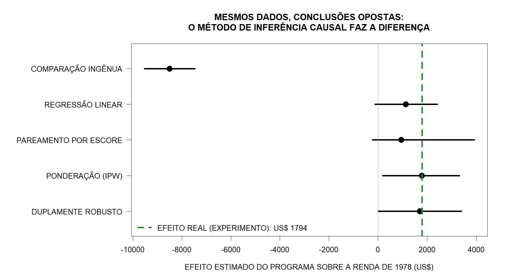
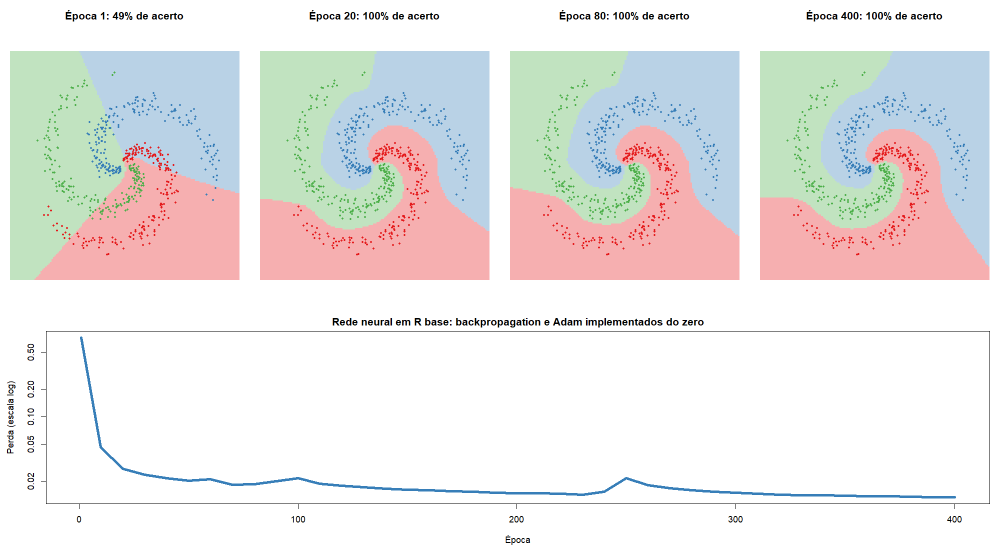
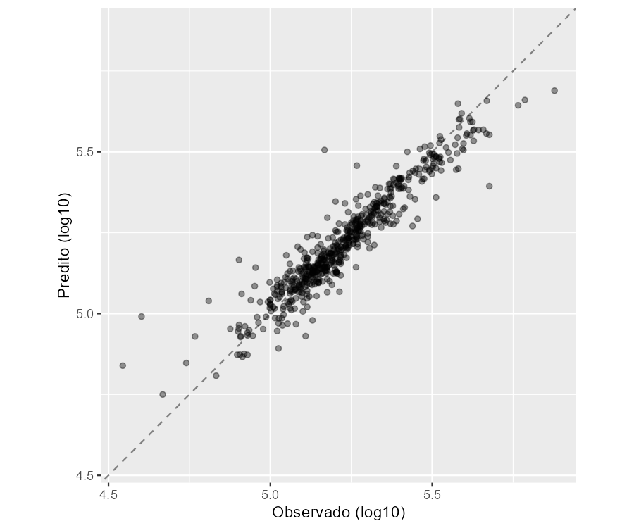
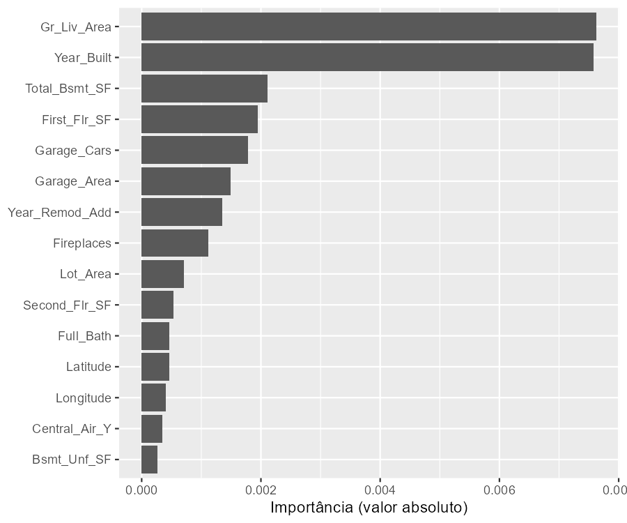
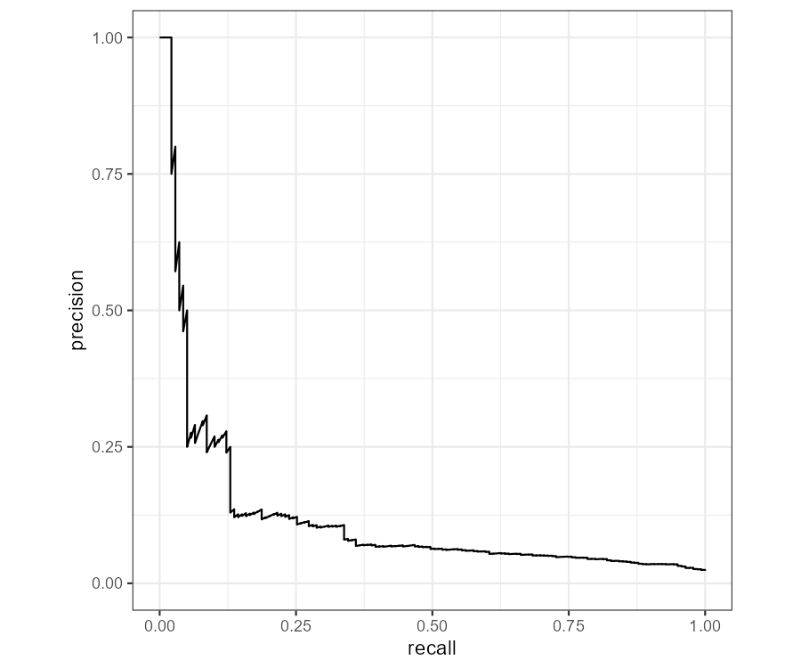
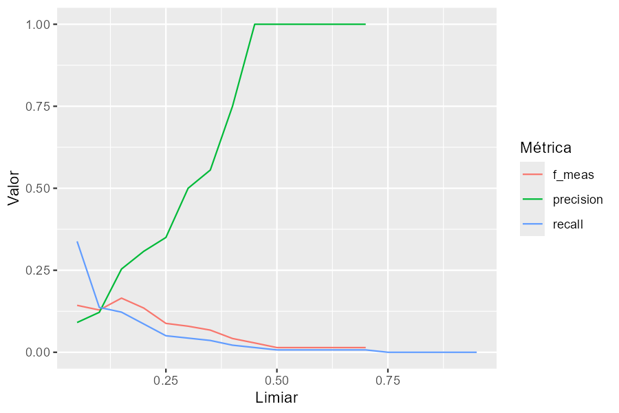
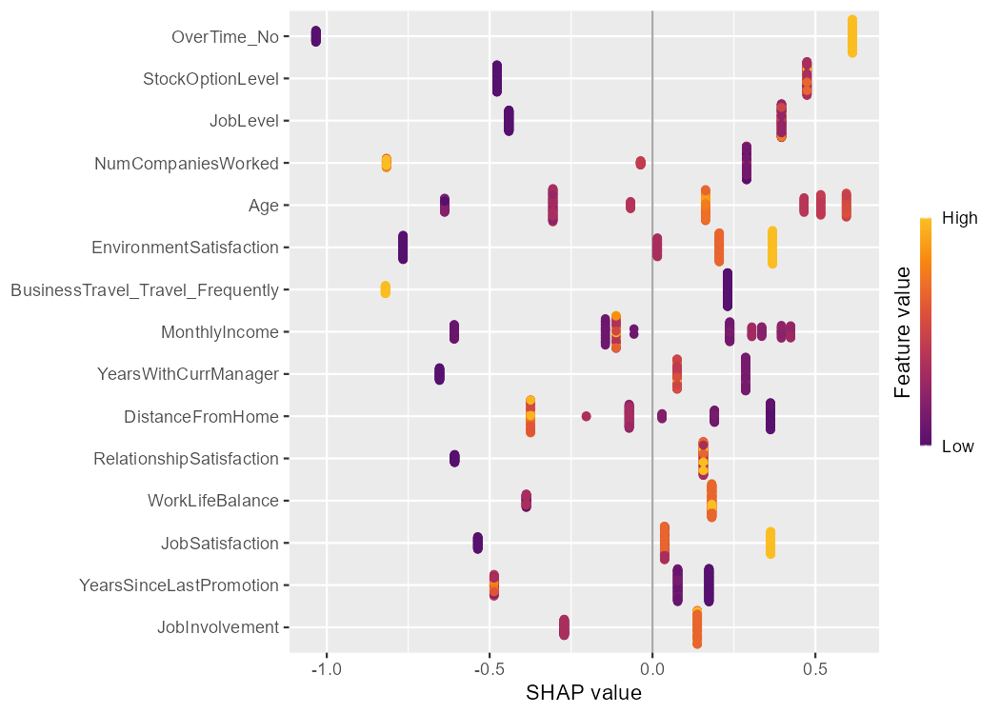
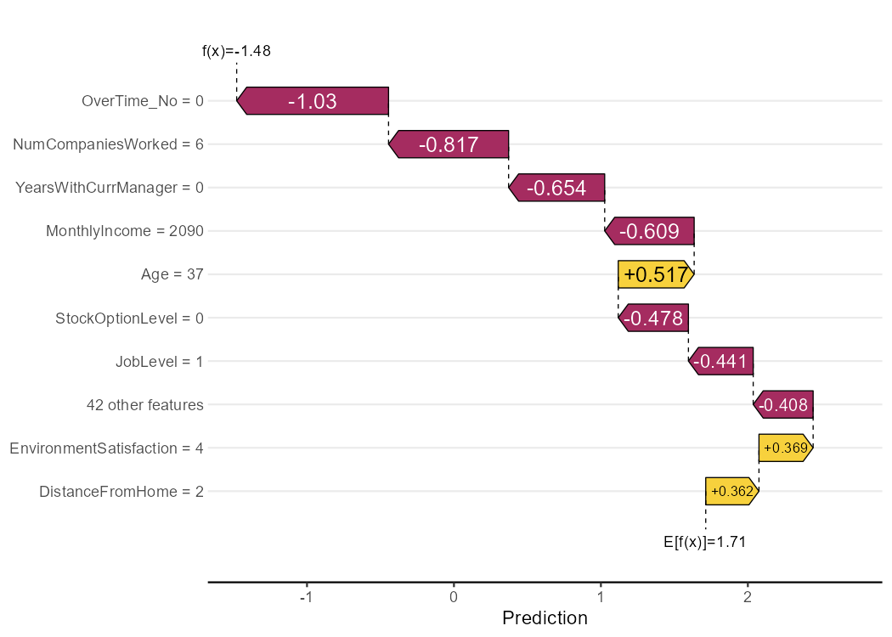
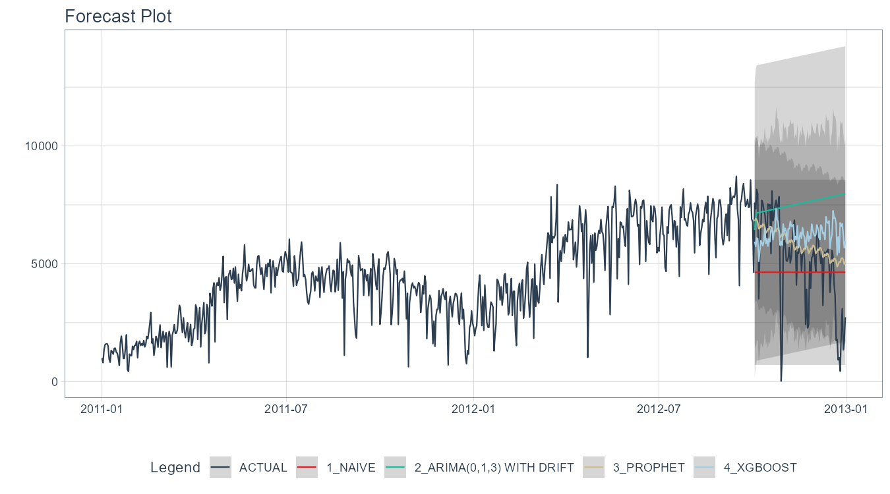

# Estudos em R

Os cinco primeiros estudos são escritos em R base, sem bibliotecas de modelagem prontas. A partir do sexto, a série entra em estatística espacial e machine learning geoespacial com dados públicos brasileiros, usando o ecossistema `sf` e `spdep`. Do oitavo ao décimo primeiro, a série passa para machine learning aplicado com `tidymodels`: regressão, classes raras, interpretabilidade e séries temporais.

## 1. Inferência causal com os dados de LaLonde (`estudo_um.R`)

Um programa de treinamento profissional (NSW) foi avaliado por sorteio, o que dá o efeito real sobre a renda: **US$ 1.794**. O estudo troca o grupo de controle sorteado por pessoas do censo (CPS) e mostra como diferentes métodos se saem ao tentar recuperar esse efeito a partir de dados observacionais:

- comparação ingênua de médias;
- regressão linear com covariáveis;
- pareamento por escore de propensão (vizinho mais próximo com caliper);
- ponderação pelo inverso da probabilidade (IPW);
- estimador duplamente robusto (regressão ponderada pelo IPW).

Os intervalos de confiança vêm de 200 reamostragens bootstrap.



| Método | Estimativa (US$) | Distância do efeito real |
|---|---:|---:|
| Comparação ingênua | -8.498 | -10.292 |
| Regressão linear | 1.137 | -657 |
| Pareamento por escore | 952 | -842 |
| IPW | 1.782 | -12 |
| Duplamente robusto | 1.702 | -92 |

## 2. Rede neural do zero (`estudo_dois.R`)

Uma rede neural totalmente conectada implementada só com álgebra de matrizes, classificando três espirais entrelaçadas:

- propagação com ReLU e softmax, perda de entropia cruzada com regularização L2;
- backpropagation verificado contra gradientes numéricos (erro relativo máximo na ordem de 1e-9);
- otimizadores Adam e SGD com mini-lotes;
- comparação entre modelo linear e rede profunda, Adam e SGD, e com e sem regularização;
- visualização das fronteiras de decisão e das ativações dos neurônios ocultos.



## 3. Teste A/B bayesiano (`estudo_tres.R`)

Um teste A/B simulado com efeito conhecido (conversão de 4,0% contra 4,6%), analisado pelas abordagens clássica e bayesiana:

- teste de duas proporções e p-valor;
- modelo Beta-Binomial conjugado, probabilidade de B ser melhor e distribuição do lift por Monte Carlo;
- perda esperada em forma fechada como regra de decisão, conferida contra a simulação;
- 2.000 testes A/A e A/B simulados para medir quanto "espiar" o resultado todo dia inflaciona os falsos positivos;
- sensibilidade à prior (uniforme, histórica e cética).

## 4. Word embeddings do zero (`estudo_quatro.R`)

Vetores de palavras construídos a partir dos seis romances de Jane Austen, sem rede neural:

- matriz de coocorrência com janela de 5 palavras, ponderada pela distância;
- PPMI com suavização de contexto e redução para 100 dimensões com SVD;
- vizinhos semânticos (contagem bruta contra embeddings) e analogias do tipo he : she :: him : ?;
- mapa semântico em 2D por PCA;
- medição do viés de gênero que o modelo aprende do corpus.

## 5. Atenção do zero (`estudo_cinco.R`)

O mecanismo de self-attention do Transformer implementado só com multiplicação de matrizes, treinado em duas tarefas escolhidas para tornar a atenção visível:

- embeddings de dígitos e de posição, projeções Q, K e V e softmax escalado por √d;
- retropropagação escrita à mão, verificada contra gradientes numéricos;
- treino com Adam em lotes gerados a cada passo;
- **inverter sequências:** a atenção aprende uma diagonal invertida, ou seja, atenção por posição;
- **encontrar o máximo:** todas as posições olham para o maior dígito, ou seja, atenção por conteúdo;
- ablação sem embeddings de posição: a atenção é invariante a permutações e não consegue inverter a sequência.

## 6. Autocorrelação espacial de homicídios (`estudo_seis.R`)

Homicídios por município na Bahia entre 2020 e 2022 (SIM/DATASUS, CID-10 X85 a Y09), com população e densidade do Censo 2022:

- taxas por 100 mil habitantes com suavização bayesiana empírica, para não confundir ruído de municípios pequenos com padrão espacial;
- vizinhança por contiguidade (queen) e pesos padronizados por linha;
- Moran global com teste de permutação (999 simulações);
- LISA para localizar hotspots (alto-alto), coldspots (baixo-baixo) e outliers espaciais;
- regressão OLS diagnosticada com testes de Rao (LM) e comparada com os modelos SAR (defasagem espacial) e SEM (erro espacial), incluindo os impactos diretos e indiretos do SAR.

Gera `homicidios_taxa.png` e `homicidios_lisa.png`.

## 7. Regiões de vulnerabilidade social: k-means contra SKATER (`estudo_sete.R`)

Seis indicadores do Atlas do Desenvolvimento Humano (Censo 2010) para os municípios da Bahia: analfabetismo, pobreza extrema, Gini, mortalidade infantil, água e esgoto inadequados e renda per capita:

- indicadores orientados na mesma direção e padronizados por z-score;
- escolha do número de grupos pelo cotovelo e pela silhueta;
- k-means, que agrupa só por semelhança, contra SKATER, que corta a árvore geradora mínima do grafo de vizinhança e produz regiões contíguas;
- tratamento de municípios-ilha (Itaparica e Vera Cruz), que deixariam o grafo desconexo;
- comparação do trade-off: homogeneidade interna e silhueta contra número de fragmentos espaciais.

Gera `vulnerabilidade_clusters.png`, com os dois mapas lado a lado.

## 8. Preço de imóveis com tidymodels (`estudo_oito.R`)

Previsão do preço de venda de imóveis de Ames (`modeldata::ames`), com o alvo em `log10` para estabilizar a variância dos preços:

- divisão treino e teste estratificada pelo preço e validação cruzada de 10 folds apenas no treino;
- receita única de pré-processamento (agrupamento de categorias raras, variáveis dummy, remoção de variância zero e normalização) compartilhada pelos dois modelos;
- Lasso (`glmnet`) contra random forest (`ranger`), ambos com hiperparâmetros ajustados em `workflow_set`;
- escolha do melhor modelo pelo RMSE da validação cruzada e avaliação única no conjunto de teste, para não vazar informação do teste na seleção;
- importância das variáveis calculada direto do motor do modelo (o pacote `vip` saiu do CRAN em 2026).

| Modelo | RMSE (validação cruzada) | R² (validação cruzada) |
|---|---:|---:|
| Random forest | 0,0625 | 0,876 |
| Lasso | 0,0659 | 0,864 |

A random forest venceu e, no conjunto de teste, chegou a **RMSE 0,0593 e R² 0,894**. O RMSE está em `log10`, então o erro típico é de cerca de 15% do preço (`10^0,0593 ≈ 1,15`). O erro de teste ficou próximo do de validação cruzada, o que indica ausência de overfitting relevante. A diferença entre os dois modelos (0,0034 de RMSE) é parecida com o erro padrão da validação cruzada (0,003 a 0,005), então a vantagem da floresta é pequena.



A importância por permutação é dominada por área construída (`Gr_Liv_Area`) e ano de construção (`Year_Built`), bem à frente das demais:



## 9. Detecção de fraude com classe rara (`estudo_nove.R`)

Transações simuladas com 2,05% de fraudes (616 em 30.000), em que a acurácia engana: dizer sempre "legítima" já acerta 97,9%. A prevalência é fixada ajustando o intercepto de uma regressão logística:

- comparação de duas receitas (sem e com SMOTE aplicado só dentro dos folds de treino) e dois modelos (regressão logística e XGBoost), totalizando quatro workflows;
- seleção pela PR-AUC, cuja linha de base é a prevalência (0,02), em vez de acurácia ou ROC-AUC;
- curva precisão-recall no conjunto de teste;
- ajuste do limiar de decisão com `probably::threshold_perf`;
- matriz de confusão no limiar com melhor F1.

| Workflow | PR-AUC (validação cruzada) | ROC-AUC |
|---|---:|---:|
| Logística | 0,127 | 0,805 |
| Logística + SMOTE | 0,127 | 0,804 |
| XGBoost + SMOTE | 0,125 | 0,760 |
| XGBoost | 0,118 | 0,743 |

Os quatro workflows ficaram estatisticamente empatados em PR-AUC (o erro padrão é de cerca de 0,02), e o SMOTE não trouxe ganho. Como a simulação tem sinal fraco, o teto de desempenho é baixo: no conjunto de teste, o vencedor nominal (a logística) teve **PR-AUC 0,119, cerca de 6 vezes a linha de base, e ROC-AUC 0,766**.



A precisão sobe com o limiar e o recall cai, e o F1 atinge o pico perto de 0,15. Nos limiares altos o modelo deixa de prever fraude e a precisão fica indefinida (o gráfico interrompe a linha):



No limiar de melhor F1 (0,15), a matriz de confusão no teste é:

| | Fraude real | Legítima real |
|---|---:|---:|
| Previsto fraude | 17 | 50 |
| Previsto legítima | 122 | 5.811 |

São 25% de precisão e 12% de recall. A acurácia desse corte (97,1%) é menor que a de "sempre legítima" (97,7%), o que mostra por que a acurácia é a métrica errada aqui. A escolha final do limiar é uma decisão de negócio: depende do custo de bloquear um cliente legítimo contra o de deixar passar uma fraude.

## 10. Interpretabilidade com SHAP e modelo empacotado (`estudo_dez.R`)

Previsão de saída de funcionários (`modeldata::attrition`) com XGBoost, explicada com valores de Shapley:

- receita com variáveis ordinais convertidas em números e nominais em one-hot, para que o SHAP seja calculado por categoria;
- ajuste de hiperparâmetros por validação cruzada e avaliação no teste com `last_fit`;
- extração do booster nativo do workflow e SHAP com `shapviz`: importância global, beeswarm com a direção do efeito e waterfall de um caso individual;
- empacotamento do workflow com `vetiver` e montagem da API com `plumber`, sem gravar nada em disco e sem iniciar o servidor.

No teste, o modelo obteve **ROC-AUC 0,865**, acurácia 0,888 e Brier 0,090. A melhor configuração da validação cruzada (ROC-AUC 0,825) usou árvores de profundidade 1, ou seja, um modelo praticamente aditivo. Com cerca de 1.470 linhas, o ROC-AUC varia bastante entre sementes, então a diferença entre validação e teste não deve ser lida como ganho real.

**Como ler o SHAP:** o `parsnip` trata o primeiro nível do desfecho (`No`) como evento, então o booster modela a probabilidade de **permanecer**. SHAP positivo favorece a permanência e SHAP negativo favorece a saída. O waterfall confirma: o valor-base é +1,71 de log-odds, cerca de 85%, que é a taxa de permanência.



Horas extras, nível de opções de ações e nível do cargo são as variáveis de maior impacto. Fazer horas extras (`OverTime_No = 0`) empurra com força para a saída. O waterfall abaixo explica um funcionário específico: horas extras, seis empresas anteriores e zero anos com o gerente atual somam os maiores empurrões para a saída, e o modelo termina em f(x) = -1,48, bem abaixo da média.



SHAP explica o modelo, não a causa no mundo real.

## 11. Previsão de demanda com séries temporais (`estudo_onze.R`)

Aluguéis diários de bicicletas (`timetk::bike_sharing_daily`), com validação respeitando a ordem do tempo:

- separação temporal, com os últimos 90 dias reservados para teste;
- quatro modelos no mesmo `modeltime_table`: baseline ingênuo (naive), ARIMA automático, Prophet e XGBoost com features de calendário (assinatura temporal e termos de Fourier);
- comparação por MAE e MASE (o MAPE fica acima de 100% porque há dias com poucos aluguéis);
- validação por janela deslizante (5 janelas de 60 dias) com média e desvio padrão por modelo, via `modeltime.resample`;
- reajuste com todos os dados e previsão dos próximos 60 dias.

| Modelo | MAE (teste único) | MASE (teste único) | MAE médio (5 janelas) | Desvio padrão |
|---|---:|---:|---:|---:|
| Naive | 1.658 | 1,79 | 1.353 | 541 |
| ARIMA (0,1,3) com drift | 2.540 | 2,74 | 1.264 | 576 |
| Prophet | 1.220 | 1,32 | 1.228 | 541 |
| XGBoost | 1.701 | 1,84 | 1.557 | 605 |

O MASE é escalonado pelo erro ingênuo de um passo dentro da amostra, então fica acima de 1 para todos os modelos neste horizonte de 60 a 90 dias. Para saber se um modelo supera o baseline, compare com a linha do naive.



- **Teste único:** o Prophet foi o melhor. O ARIMA com drift foi o pior, porque extrapolou a tendência de alta para um período em que a demanda caiu (a queda aparece no fim de 2012).
- **Cinco janelas:** o Prophet segue com o menor MAE, mas naive, ARIMA e Prophet ficam dentro de um desvio padrão uns dos outros (as diferenças são menores que 150 contra desvios de cerca de 550), então não há vencedor claro. O XGBoost é o único consistentemente pior, porque árvores não extrapolam tendência.
- A diferença entre o ranking do teste único e o das janelas mostra por que um único teste engana.

## Como executar

Requer R 4.x. O primeiro estudo usa os dados do pacote `causaldata`, e o quarto, os do `janeaustenr`:

```r
install.packages(c("causaldata", "janeaustenr"))
```

Os estudos 6 e 7 instalam os próprios pacotes quando necessário (`sf`, `geobr`, `spdep`, `spatialreg`, `sidrar`, `abjData` e `microdatasus`, este último pelo GitHub) e precisam de internet para baixar malhas e dados do IBGE, DATASUS e Atlas Brasil.

Os estudos 8 a 11 também instalam os próprios pacotes no início (`tidymodels`, `themis`, `xgboost`, `shapviz`, `vetiver`, `modeltime`, `modeltime.resample`, `timetk` e `prophet`, entre outros). Todos os dados vêm de pacotes ou são simulados, então não precisam de internet além da instalação. No Windows, o `prophet` às vezes falha por depender do `rstan`; nesse caso, remova o `mod_prophet` do estudo 11.

```bash
Rscript estudo_um.R     # cerca de 1 minuto por causa do bootstrap
Rscript estudo_dois.R   # cerca de 1 minuto
Rscript estudo_tres.R   # menos de 1 minuto
Rscript estudo_quatro.R # depende do SVD de uma matriz 3000 x 3000, de 1 a alguns minutos
Rscript estudo_cinco.R  # três treinos de 2.000 passos, alguns minutos
Rscript estudo_seis.R   # o download do SIM pelo FTP do DATASUS domina o tempo
Rscript estudo_sete.R   # menos de 1 minuto depois de instalados os pacotes
Rscript estudo_oito.R   # ajuste de dois modelos com validação cruzada, alguns minutos
Rscript estudo_nove.R   # quatro workflows com SMOTE e XGBoost, alguns minutos
Rscript estudo_dez.R    # ajuste do XGBoost e cálculo do SHAP, alguns minutos
Rscript estudo_onze.R   # o auto_arima nas 5 janelas domina o tempo
```

Cada script gera os seus gráficos principais em PNG na pasta atual e imprime as métricas no console.
