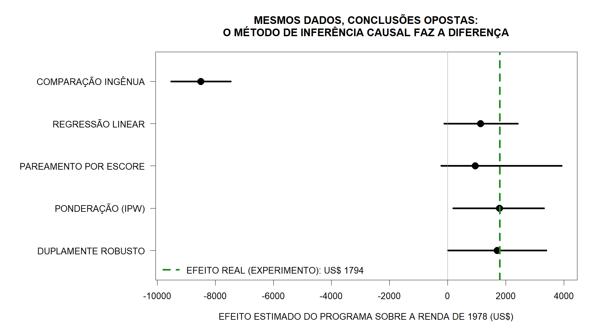
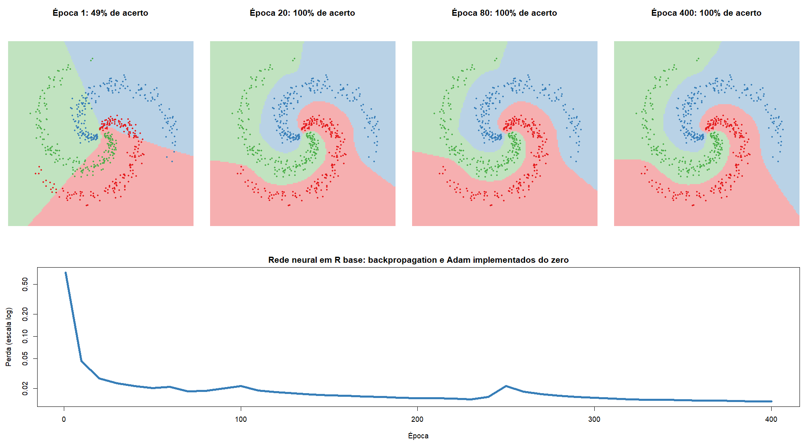

# Estudos em R

Quatro estudos escritos em R base, sem bibliotecas de modelagem prontas.

## 1. Inferência causal com os dados de LaLonde (`estudo_um.R`)

Um programa de treinamento profissional (NSW) foi avaliado por sorteio, o que dá o efeito real sobre a renda: **US$ 1.794**. O estudo troca o grupo de controle sorteado por pessoas do censo (CPS) e mostra como diferentes métodos se saem ao tentar recuperar esse efeito a partir de dados observacionais:

- comparação ingênua de médias;
- regressão linear com covariáveis;
- pareamento por escore de propensão (vizinho mais próximo com caliper);
- ponderação pelo inverso da probabilidade (IPW);
- estimador duplamente robusto (regressão ponderada pelo IPW).

Os intervalos de confiança vêm de 200 reamostragens bootstrap.



| Método | Estimativa (US$) | Distância do efeito real |
|---|---:|---:|
| Comparação ingênua | -8.498 | -10.292 |
| Regressão linear | 1.137 | -657 |
| Pareamento por escore | 952 | -842 |
| IPW | 1.782 | -12 |
| Duplamente robusto | 1.702 | -92 |

## 2. Rede neural do zero (`estudo_dois.R`)

Uma rede neural totalmente conectada implementada só com álgebra de matrizes, classificando três espirais entrelaçadas:

- propagação com ReLU e softmax, perda de entropia cruzada com regularização L2;
- backpropagation verificado contra gradientes numéricos (erro relativo máximo na ordem de 1e-9);
- otimizadores Adam e SGD com mini-lotes;
- comparação entre modelo linear e rede profunda, Adam e SGD, e com e sem regularização;
- visualização das fronteiras de decisão e das ativações dos neurônios ocultos.



## 3. Teste A/B bayesiano (`estudo_tres.R`)

Um teste A/B simulado com efeito conhecido (conversão de 4,0% contra 4,6%), analisado pelas abordagens clássica e bayesiana:

- teste de duas proporções e p-valor;
- modelo Beta-Binomial conjugado, probabilidade de B ser melhor e distribuição do lift por Monte Carlo;
- perda esperada em forma fechada como regra de decisão, conferida contra a simulação;
- 2.000 testes A/A e A/B simulados para medir quanto "espiar" o resultado todo dia inflaciona os falsos positivos;
- sensibilidade à prior (uniforme, histórica e cética).

## 4. Word embeddings do zero (`estudo_quatro.R`)

Vetores de palavras construídos a partir dos seis romances de Jane Austen, sem rede neural:

- matriz de coocorrência com janela de 5 palavras, ponderada pela distância;
- PPMI com suavização de contexto e redução para 100 dimensões com SVD;
- vizinhos semânticos (contagem bruta contra embeddings) e analogias do tipo he : she :: him : ?;
- mapa semântico em 2D por PCA;
- medição do viés de gênero que o modelo aprende do corpus.

## Como executar

Requer R 4.x. O primeiro estudo usa os dados do pacote `causaldata`, e o quarto, os do `janeaustenr`:

```r
install.packages(c("causaldata", "janeaustenr"))
```

```bash
Rscript estudo_um.R     # cerca de 1 minuto por causa do bootstrap
Rscript estudo_dois.R   # cerca de 1 minuto
Rscript estudo_tres.R   # menos de 1 minuto
Rscript estudo_quatro.R # depende do SVD de uma matriz 3000 x 3000, de 1 a alguns minutos
```

Cada script gera o seu gráfico principal em PNG na pasta atual.
